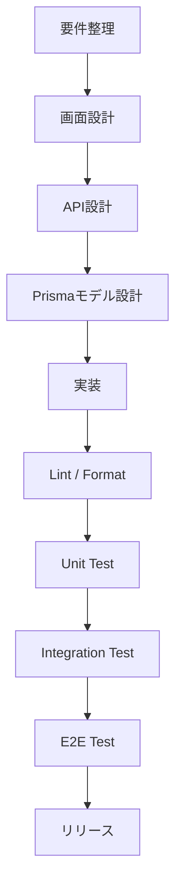

### `docs/MEMO.md`
```markdown 
# 家計簿アプリ 開発メモ（MEMO）

---

# =========================
# 1. プロジェクト概要
# project overview
# =========================

本プロジェクトは、レシート形式で入力できる
「フルスタック家計簿アプリ」です。

フロントエンド（Next.js）と
バックエンド（Express + Prisma）を分離し、
Docker + MySQL 環境で構築しています。

主な目的：

- レシート単位の家計管理
- 複数明細入力
- カテゴリ別集計
- 保守性を重視したAPI設計
- QA（品質保証）を意識した開発

---

# =========================
# 2. 技術構成
# tech stack
# =========================

## Frontend

- Next.js
- React
- TypeScript
- Chakra UI
- Vitest
- Cypress

## Backend

- Express
- Prisma
- MySQL
- TypeScript
- Vitest
- Supertest

## Infrastructure

- Docker
- Docker Compose

## QA / Code Quality

- ESLint
- Prettier
- TypeScript strict mode

---

# =========================
# 3. MVP定義
# MVP definition
# =========================

MVP（最小実装範囲）は以下。

## 実装対象

- 取引登録
- 明細追加
- カテゴリ管理
- 口座管理
- 履歴一覧
- 編集
- 削除

## 実装しないもの

- ログイン認証
- クラウド同期
- AI分析
- 通知
- グラフ分析

---

# =========================
# 4. ディレクトリ構成
# directory structure
# =========================

```text
project-root/
├── front/
│   ├── src/
│   ├── cypress/
│   └── public/
│
├── api/
│   ├── prisma/
│   ├── src/
│   │   ├── router/
│   │   ├── utils/
│   │   └── __tests__/
│   └── scripts/
│
└── docs/
```

---

# =========================
# 5. 開発方針
# development policy
# =========================

## 基本思想

- 最小変更原則
- 既存仕様を壊さない
- any禁止
- Prisma経由のみDB操作
- API責務を明確化

## コード品質

- ESLintによる静的解析
- Prettierによる自動整形
- Vitestによる単体テスト
- SupertestによるAPI検証
- CypressによるE2E検証

---

# =========================
# 6. 注意点
# important notes
# =========================

## db.jsonについて

現在、Store（店舗）のみ
一時的に db.json 管理を継続。

将来的には Prisma + MySQL に完全移行予定。

## app.ts と server.ts

- app.ts
  → Express定義専用

- server.ts
  → listen専用

分離することで：

- テスト高速化
- Supertest対応
- 責務分離

を実現。

---

# =========================
# 7. テスト方針
# testing strategy
# =========================

## Unit Test

- ロジック検証
- 共通関数検証
- バリデーション検証

## Integration Test

- Prisma連携
- DB接続
- APIレスポンス検証

## E2E Test

- 画面操作
- 登録〜履歴反映
- 実運用シナリオ

---

# =========================
# 8. 開発フロー
# development flow
# =========================

