## 1. プロジェクト概要
本プロジェクトは、Next.js（フロントエンド）とExpress（バックエンド）をサーバー間通信で連携させ、Prisma/MySQLでデータ管理を行う、管理画面付きのフルスタック・ポートフォリオアプリケーションです。

### リポジトリ
個人アカウント配下の private リポジトリ `github.com/yukienozawa/portfolio` で開発・管理する（旧: `ms-engineer-bc26-04/yukie_section_6-5` から履歴ごと個人リポジトリへ移行済み）。デプロイ・動作確認が完了次第、Publicへ切り替える。

### MVP（Minimum Viable Product）定義
「最小限の労力でアイデアを検証する」という原則に基づき、初回のゴールを以下に限定します。
- **公開側**: プロフィールおよび実績一覧をデータベースから動的に取得・表示できること。
- **管理側**: Firebase Authenticationによるログイン後、実績のテキスト情報を登録・更新（CRUD）できること。
- **品質基準**: strict TypeScriptの遵守、Airbnb規約、MDN準拠の命名、基本単体テスト（テスト込み実装）の合格。

---

## 2. 技術構成
提供されたコンテキストおよび想定される構成に基づき、以下のスタックを採用します。

| レイヤー | 技術スタック | 補足・制約 |
| :--- | :--- | :--- |
| **Frontend** | Next.js (App Router), TypeScript | `strict: true` / `proxy.ts`（Next.js 16でのmiddleware後継）による認可制御 |
| **Backend** | Express, TypeScript | Vercelのサーバーレス関数として同一プロジェクト内にホスト |
| **ORM** | Prisma | スキーマ駆動開発。サーバーレス対応として `connection_limit=1` + シングルトンパターンを採用 |
| **Database** | MySQL | 本番はAiven for MySQL（Free Plan） |
| **Auth** | Firebase Authentication | Admin SDKを用いたバックエンド/`proxy.ts`双方での二重認可 |
| **Linter/Formatter**| ESLint (Airbnb), Prettier | 代码品質の自動統一 |
| **Hosting** | Vercel（Hobbyプラン） | フロント・バックエンドを1プロジェクトに統合。Render等の外部バックエンドサービスは不使用。デプロイは成功済み |
| **Cache** | Redis | ※Advanced要件（MVP完成後に導入判断） |

---

## 3. 開発方針
- **テスト込み実装の徹底**: すべての機能成果物は「テストコードが同梱されていること」をマージ条件とします。
- **セキュリティ（存在の隠蔽）**: 未認証またはAdmin権限のないユーザーが `/admin` 関連のリソースにアクセスした場合、リダイレクトではなく **HTTP 404（Not Found）** を応答し、管理画面の存在自体を隠蔽します。管理画面のセキュリティ境界は `proxy.ts`（Edge）とバックエンドの `verifySessionCookie` の二重構造とし、フロントの `onAuthStateChanged` のみに依存しない。

---

## 4. 開発フロー図解

以下のフローは、実装が完了した項目を反映して更新しています（★=完了）。

```mermaid
graph TD
    classDef done fill:#bfb,stroke:#333,stroke-width:2px;
    classDef inprogress fill:#ffb,stroke:#333,stroke-width:2px;
    classDef planned fill:#eee,stroke:#333,stroke-width:1px;

    %% 基盤構築（★完了）
    P1_1[タスク1: プロジェクト初期化] --> P1_2[ESLint Airbnb / Prettier設定]
    P1_2 --> P2_1[タスク2: Prisma Schema定義 User/Achievement/Skill]
    class P1_1,P1_2,P2_1 done;

    %% データ・認証基盤（★完了）
    P2_1 --> P2_2[MySQLテーブル作成 npx prisma db push]
    P2_2 --> P3_1[Firebase Admin SDK導入]
    P3_1 --> P3_2[認可Middleware実装 未認証時404応答]
    P3_2 --> P3_3[セッションCookie検証 Firebase Admin SDK]
    class P2_2,P3_1,P3_2,P3_3 done;

    %% バックエンドAPI開発（★完了）
    P3_3 --> P4_1[API: GET /api/achievements 実績取得]
    P4_1 --> P4_2[API: POST /api/admin/achievements 実績登録]
    P4_2 --> P4_3[API: POST /api/contact 問い合わせ]
    P4_3 --> P4_4[お問い合わせ機能のON/OFF切り替え]
    class P4_1,P4_2,P4_3,P4_4 done;

    %% フロントエンド実装（★完了）
    P4_4 --> P5_1[Next.js App Router: 公開ページ群]
    P5_1 --> P5_2[Next.js App Router: 管理画面 /admin]
    class P5_1,P5_2 done;

    %% テスト・品質強化（★完了）
    P5_2 --> P5_3[テストカバレッジ計測環境構築]
    class P5_3 done;

    %% デプロイ（実質完了、最終確認のみ残る）
    P5_3 --> P6_1[個人リポジトリへの移行 github.com/yukienozawa/portfolio]
    P6_1 --> P6_2[Vercel統合構成でのデプロイ]
    P6_2 --> P6_2a[Prismaバージョン問題の解決 postinstall/build両対応]
    P6_2a --> P6_2b[vercel.json builds設定によるfront/api分離ビルド]
    P6_2b --> P6_2c[本番データ移行 Achievement/User]
    P6_2c --> P6_2d[本番URL確定 環境変数の反映]
    P6_2d --> P6_3[main反映後の本番動作確認]
    P6_3 --> P6_4[リポジトリをPublicへ切り替え]
    class P6_1,P6_2,P6_2a,P6_2b,P6_2c,P6_2d done;
    class P6_3,P6_4 inprogress;

    %% 最適化・拡張（未着手）
    P6_4 --> P7_1[機能拡張: 画像保存処理の見直し]
    P7_1 --> P7_2[最適化: Redisキャッシュ導入検討]
    class P7_1,P7_2 planned;
```

---

## 5. Git運用とデプロイの関係（重要）

- 日常の開発は `develop` を基準に `feature/機能名` ブランチで進める（詳細は `rules.md`）
- `main` は **リリース済み・デプロイ対象のブランチ**として運用する。Vercelの Production Branch は `main` を参照するため、デプロイ前には必ず `develop` → `main` のマージを行い、乖離がないことを確認する（詳細は `デプロイsetup.md` 4章・6-4節）

---

## 6. 現時点で残っているタスク（2026年7月時点）

デプロイ自体（ビルド成功・Aiven DB接続・本番データ反映・環境変数更新・ドメイン設定）は完了しており、残っているのは以下の最終確認・後片付け系のタスクのみ。

1. `develop` → `main` のPR作成・マージ（Production Branchへの初回反映）
2. `main`反映後の本番動作確認（Home/Profile/Works/Contact表示、`/admin`未認証時の404確認、お問い合わせフォーム送信テスト）
3. リポジトリのPublic化
4. マージ済みローカルブランチの削除（`feature/docs-update`等、多数残存）
5. E2Eテスト（Cypress）導入、フロント単体テスト基盤構築（デプロイ完了後の課題として先送り）